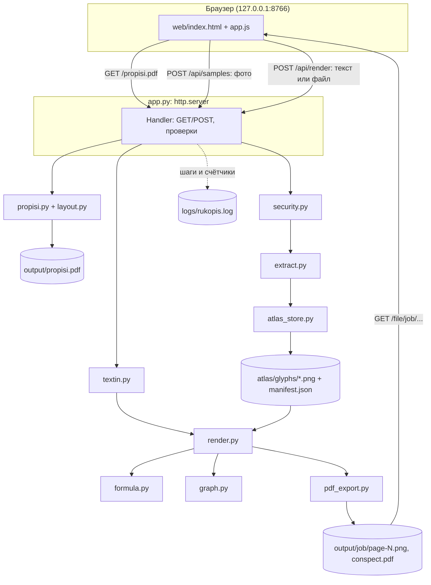

# Рукопись: локальный рендер текста своим почерком

«Рукопись» учится на почерке пользователя и переписывает готовый текст «от руки» на страницы тетради. Результат: PNG-картинки страниц и общий PDF. Программа работает целиком на своём компьютере, без облака, нейросетей и внешних API. Фото почерка никуда не отправляются.

## Содержание
1. [Зачем это](#зачем-это)
2. [Возможности](#возможности)
3. [Архитектура и поток данных](#архитектура-и-поток-данных)
4. [Как снимается почерк](#как-снимается-почерк)
5. [Как рисуется страница](#как-рисуется-страница)
6. [Примеры ввода](#примеры-ввода)
7. [HTTP-интерфейс](#http-интерфейс)
8. [Настройки и лимиты](#настройки-и-лимиты)
9. [Установка и запуск](#установка-и-запуск)
10. [Тесты](#тесты)
11. [Приватность и безопасность](#приватность-и-безопасность)
12. [Структура проекта](#структура-проекта)
13. [Ограничения и планы](#ограничения-и-планы)

## Зачем это

Иногда текст нужен именно в рукописном виде: открытка, подпись к работе, оформление заметок, макет для дизайна. Онлайн-сервисы «рукописных шрифтов» дают чужой почерк и требуют загрузить свой текст в облако. «Рукопись» использует твой собственный почерк и ничего не отправляет в сеть. Главная идея проекта: **приватность by design** и честность результата (если буквы нет, программа это показывает, а не подменяет).

## Возможности

* Генерация **листов-прописей** в PDF: 145 знаков на 4 листах A4.
* Распознавание **фото заполненных прописей**: поиск угловых меток, выравнивание перспективы, номер листа, нарезка клеток, отделение чернил от серой подсказки.
* **Азбука почерка**: по одному глифу на знак, хранится локально.
* Ввод текста вставкой или файлом **txt, md, pdf, docx**.
* Режим **«чуть ужать»**: оставляет заголовки, нумерованные пункты, формулы, графики и короткие строки.
* **Вёрстка** по страницам с переносом по словам, заголовки выделяются маркером.
* **Формулы из своих знаков**: степень `x^2`, индекс `a_1`, дробь `\frac{a}{b}`, корень `\sqrt{x}`.
* **Графики** функций из белого списка (matplotlib) по строке `график: ...`.
* **Жёлтая клетка** вместо отсутствующего знака плюс подсказка внизу страницы «Допиши в пропись: …». Чужая буква не подставляется.
* Экспорт в **PNG и PDF**.
* Локальный **веб-интерфейс** на три шага.

## Архитектура и поток данных

Один процесс на Python: стандартный `http.server` (без веб-фреймворка) отдаёт страницу и обрабатывает загрузки. Вся работа идёт в модулях пакета `rukopis/`.



Три шага пользователя:
1. **Прописи.** `GET /propisi.pdf`: `layout.py` раскладывает знаки по сетке, `propisi.py` рисует листы и собирает PDF.
2. **Азбука.** `POST /api/samples` с фото: `security.py` проверяет файлы, `extract.py` выравнивает каждое фото и режет клетки, `atlas_store.py` сохраняет глифы.
3. **Страницы.** `POST /api/render` с текстом: `textin.py` читает и при необходимости ужимает текст, `render.py` верстает страницы (формулы через `formula.py`, графики через `graph.py`), `pdf_export.py` собирает PDF. Каждый рендер получает свою папку `output/<job>/` со случайным id.

## Как снимается почерк

**Лист-пропись** (`layout.py`, `propisi.py`)
* Страница 1240×1754 px (A4 при 150 dpi), сетка 6×8 клеток по 168 px.
* Знаки: русские прописные и строчные (33+33), цифры, `+ − = ( ) / ^ √ - . , : ; ! ? % *`, латиница (26+26). Всего 145 знаков, это 4 листа.
* В каждой клетке серым напечатан знак, который нужно обвести или написать поверх.
* По углам 4 чёрных квадрата для выравнивания. Сверху 3 квадрата-бита с номером листа (двоичный код), поэтому листы можно фотографировать в любом порядке.
* Шрифт для серых подсказок ищется по списку путей Windows, macOS и Linux (Arial, Segoe UI, DejaVu Sans, Liberation Sans).

**Разбор фото** (`extract.py`)
1. Фото уменьшается до 1800 px по длинной стороне.
2. В каждом углу ищется тёмное пятно метки (порог яркости, заливка связной области, центр масс). Проверяется, что метки действительно разнесены по углам.
3. По 4 парам точек решается система 8×8 и строится **гомография** (проективное преобразование), фото переводится в ровный лист эталонного размера.
4. По битовым квадратам читается номер листа и берётся нужная раскладка клеток.
5. Каждая клетка обрезается с отступом. Пиксель считается чернилами, если его самый тёмный канал RGB меньше порога `INK_MAX = 110`. Серая подсказка светлее и в глиф не попадает.
6. Если чернил меньше 40 пикселей, клетка пустая. Иначе глиф обрезается по границам и сохраняется как PNG с прозрачным фоном.

**Азбука** (`atlas_store.py`): `atlas/glyphs/<код Unicode>.png` и `atlas/manifest.json` (знак → файл, список пустых клеток). Новая загрузка фото заменяет азбуку целиком.

## Как рисуется страница

`render.py`:
* Лист в линейку с полем (голубые линии, красная линия поля), отступы 96/70/90/90 px.
* Каждое слово собирается из глифов как формула (`formula.py`) и масштабируется к высоте строки 36 px. Слова переносятся по ширине строки.
* Строки, начинающиеся с `#` или `1.` / `1)`, считаются заголовками и подсвечиваются розовым маркером.
* Строка `график: ...` превращается в картинку matplotlib, вписанную в ширину страницы. Если график не разобран, пишется «График не нарисован.».
* Отсутствующий знак рисуется жёлтым прямоугольником, а внизу страницы появляется список «Допиши в пропись: …».
* Не больше 30 страниц за один рендер.

`formula.py`: маленький разборщик в дерево узлов: символ, степень/индекс (`^`, `_`, группы в `{}`), дробь `\frac{}{}`, корень `\sqrt{}`. Степень поднимается и уменьшается, индекс опускается, дробь рисуется с чертой, корень со знаком `√` и чертой сверху.

`graph.py`: строка проверяется регулярным выражением, функция берётся только из белого списка. Текст **никогда не исполняется как код** (нет `eval`). Проверяется область определения: логарифм только при x > 0, корень при x ≥ 0.

## Примеры ввода

```text
# Логарифмы
1) Определение
log_2 8 = 3, потому что 2^3 = 8
Свойство: log_a(xy) = log_a x + log_a y
Дробь: \frac{a+b}{2}, корень: \sqrt{x^2+1}
график: y = log2(x) от 0.1 до 8
```

Поддерживаемые графики:

| Строка | Что рисуется |
|---|---|
| `график: y = log2(x) от 0.1 до 8` | двоичный логарифм |
| `график: y = ln(x) от 0.5 до 10` | натуральный логарифм |
| `график: y = log10(x) от 1 до 100` | десятичный логарифм |
| `график: y = sqrt(x) от 0 до 9` | корень |
| `график: y = exp(x) от -2 до 2` | экспонента |
| `график: y = sin(x) от -3.14 до 3.14` | синус |
| `график: y = x^2 от -3 до 3` | парабола |
| `график: y = 2*x+1 от -5 до 5` | прямая `k*x+b` |

Режим «Чуть ужать» на таком тексте оставит заголовки, строки с `^`, `_`, `=`, `√`, `\frac`, `\sqrt`, строку графика и все строки короче 160 символов.

## HTTP-интерфейс

Используется только страницей, наружу не открыт.

| Метод | Путь | Что делает |
|---|---|---|
| GET | `/` , `/app.js` | страница и скрипт |
| GET | `/propisi.pdf` | сгенерировать и отдать прописи |
| GET | `/api/atlas` | список знаков в азбуке и пустых клеток |
| GET | `/glyph/<hex>` | картинка глифа по коду Unicode |
| POST | `/api/samples` | multipart, поле `photo` (до 8 файлов): собрать азбуку |
| POST | `/api/render` | multipart: `text`, `mode` (`ready` или `short`), необязательный файл `material` |
| GET | `/file/<job>/page-N.png`, `/file/<job>/conspect.pdf` | результат рендера |

Ответы API в JSON: `{"ok": true, ...}` или `{"ok": false, "message": "..."}` с понятным текстом ошибки.

## Настройки и лимиты

Конфигурационных файлов и переменных окружения нет: всё задано константами в коде.

| Константа | Где | Значение |
|---|---|---|
| `HOST`, `PORT` | `rukopis/security.py` | `127.0.0.1`, `8766` (другой хост запрещён) |
| `MAX_BYTES` | `security.py` | 15 МБ на файл |
| `MAX_REQUEST_BYTES` | `security.py` | 40 МБ на запрос |
| `MAX_PHOTOS` | `security.py` | 8 фото за раз |
| Разрешённые типы | `security.py` | фото: png, jpg, jpeg, webp; текст: txt, md, pdf, docx |
| `MAX_CHARS`, `MAX_PDF_PAGES` | `rukopis/textin.py` | 200 000 символов, 40 страниц PDF |
| `MAX_PAGES` | `rukopis/render.py` | 30 страниц на рендер |
| `INK_MAX`, `MIN_INK_PIXELS` | `rukopis/extract.py` | порог чернил 110, минимум 40 пикселей |
| `FONT_CANDIDATES` | `rukopis/propisi.py` | пути к системным шрифтам |

## Установка и запуск

Нужен Python 3.10+. Интернет нужен только один раз, чтобы поставить библиотеки (Pillow, NumPy, matplotlib, pypdf, python-docx, около 200..300 МБ).

**Windows:** двойной щелчок по `start.bat`. При первом запуске он создаст `.venv` и поставит зависимости.

**Linux / macOS:**

```bash
./start.sh
```

**Вручную:**

```bash
python3 -m venv .venv
. .venv/bin/activate              # Windows: .venv\Scripts\activate
pip install -r requirements.txt
python app.py
```

Открыть `http://127.0.0.1:8766/`, остановить: Ctrl+C или закрыть окно. Пошаговая инструкция для пользователя без технического опыта: [`ИНСТРУКЦИЯ.md`](ИНСТРУКЦИЯ.md).

## Тесты

```bash
python -m unittest tests.test_checkpoints -v
```

12 проверок на синтетических данных, без настоящего почерка: тест сам «пишет» в клетки прописей и перекашивает лист, как на фото.

| Тест | Что проверяет |
|---|---|
| `test_propisi_has_letters_digits_signs_and_markers` | на листах есть все нужные знаки и угловые метки |
| `test_control_extract_matches_labels_and_skips_empty` | после перекоса глифы находятся на своих местах, пустая клетка пропущена |
| `test_gray_hint_is_not_ink` | серая подсказка не считается чернилами |
| `test_line_wraps_inside_page` | строки не выходят за поле |
| `test_power_sits_above_and_index_below` | степень выше строки, индекс ниже |
| `test_log2_points_and_drawn_curve` | значения `log2` и нарисованная кривая |
| `test_missing_sign_is_yellow_and_not_replaced` | нет знака → жёлтая клетка, без подмены |
| `test_pdf_page_count_matches_images` | в PDF столько же страниц, сколько картинок |
| `test_short_mode_keeps_heading_and_graph` | «ужать» сохраняет заголовок и график |
| `test_uploads_and_paths_are_limited` | запрет чужих типов, больших файлов, выхода из папки, хоста не 127.0.0.1 |
| `test_log_skips_conspect_text` | текст не попадает в лог |
| `test_samples_folder_is_ignored_by_git` | приватные папки в `.gitignore` |

## Приватность и безопасность

* Сервер слушает только `127.0.0.1`. Попытка поднять его на другом адресе останавливается проверкой `assert_local_bind`.
* Нет сетевых вызовов: ни облака, ни аналитики, ни внешних шрифтов и CDN.
* Загрузки: белый список расширений, лимиты размера и количества, очистка имён файлов. Фото сохраняются под случайными именами.
* Защита путей: `safe_child` не даёт выйти за пределы папок программы (`..`, слэши, абсолютные пути). Скачивание файлов только по строгим шаблонам `job` и имён.
* Графики без `eval`: только белый список функций.
* Журнал `logs/rukopis.log` пишет шаг, размеры и счётчики. Поля с текстом (`text`, `content`, `line` и т.п.) вырезаются.
* `samples/`, `atlas/`, `output/`, `logs/` в `.gitignore`: почерк и результаты не попадают в репозиторий.

## Структура проекта

```
rukopis/
├── app.py               # локальный HTTP-сервер и обработчики
├── rukopis/
│   ├── layout.py        # раскладка знаков, метки, биты номера листа
│   ├── propisi.py       # рисование прописей, поиск шрифта, PDF
│   ├── extract.py       # выравнивание фото (гомография) и нарезка глифов
│   ├── atlas_store.py   # хранение азбуки
│   ├── textin.py        # чтение txt/md/pdf/docx и режим «ужать»
│   ├── formula.py       # разбор и рисование формул
│   ├── graph.py         # графики из белого списка
│   ├── render.py        # вёрстка страниц
│   ├── pdf_export.py    # сборка PDF
│   ├── security.py      # хост, лимиты, проверки файлов и путей
│   └── logutil.py       # журнал без текста
├── web/                 # index.html и app.js
├── tests/test_checkpoints.py
├── samples/ atlas/ output/ logs/   # локальные данные (в git только .gitkeep)
├── start.bat  start.sh
├── requirements.txt
└── ИНСТРУКЦИЯ.md        # инструкция для пользователя
```

## Ограничения и планы

* Один глиф на знак, поэтому одинаковые буквы выглядят одинаково. План: несколько вариантов на знак и случайный выбор.
* Буквы не соединяются между собой, как в настоящем слитном письме.
* Распознавание по простым порогам яркости. Плохой свет, тени, обрезанные углы или бледная ручка ухудшают результат.
* Новая загрузка фото заменяет азбуку, а не дополняет её.
* Нет «умного» пересказа текста: режим «ужать» только фильтрует строки.
* Формулы ограничены степенью, индексом, дробью и корнем. Графики только из белого списка.
* Нет экспорта в Word: страница это картинка, её место в PDF.
* Интерфейс однопользовательский, только для своего компьютера.
